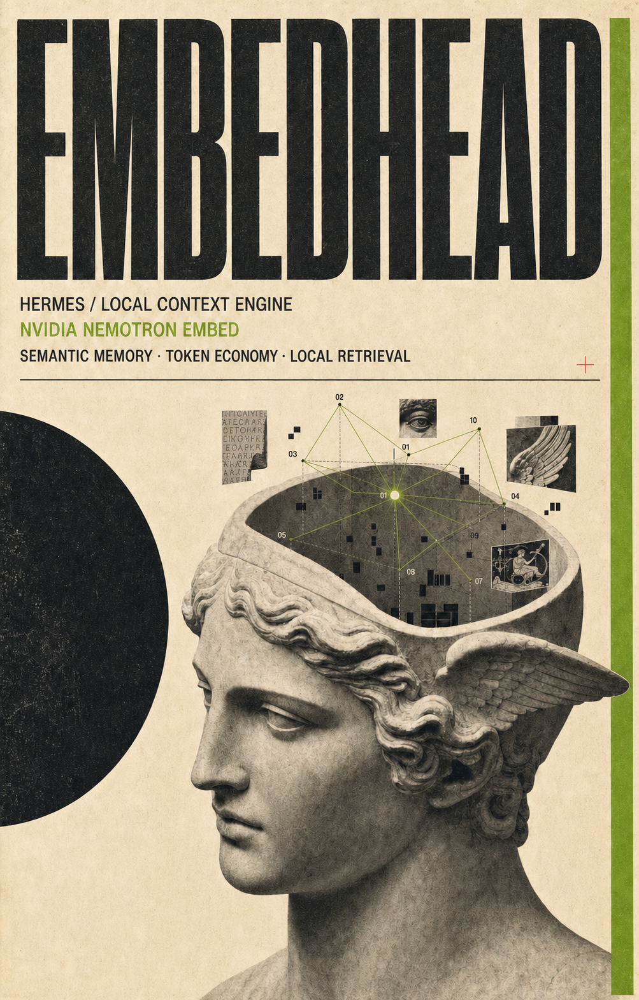

# Hermes Nemotron Embed

[](https://github.com/newjordan/hermes-nemotron-embed/actions/workflows/ci.yml)

<p align="center">
  
</p>

A standalone [Hermes Agent](https://github.com/NousResearch/hermes-agent)
context engine that uses a locally served NVIDIA Nemotron 3 Embed model to
retain query-relevant conversation turns when the context window fills.

Think of it as an **Embedhead** for Hermes: a local retrieval sidecar that
decides which older turns still deserve scarce model context.

It is not a replacement for Hermes' reasoning model. It reduces the context
sent to that model after compaction is due, keeps the local embedding workload
off paid APIs, and archives omitted turns for later semantic recovery.

## Install and activate

```bash
hermes plugins install newjordan/hermes-nemotron-embed --enable
hermes nemotron-embed setup --start
```

The setup command performs both activation steps: it writes the plugin settings
and selects `context.engine: nemotron-embed`. Restart a long-running gateway so
new sessions use it:

```bash
hermes gateway restart
hermes nemotron-embed status
```

Managed serving uses `uvx` and NVIDIA's validated `vllm==0.25.0`. It binds to
`127.0.0.1` only. The first start downloads vLLM and the selected Hugging Face
checkpoint, which can take several minutes and substantial disk space.
Managed startup also disables vLLM usage telemetry (`VLLM_NO_USAGE_STATS=1`
and `DO_NOT_TRACK=1`).

### Requirements

- A Hermes Agent release with context-engine plugin support
- Linux or WSL2 for managed vLLM startup
- `uv`/`uvx`
- A CUDA-capable NVIDIA GPU and a compatible driver

The automated compatibility suite currently tests Python 3.11–3.13 against
Hermes Agent 0.18.2 at commit `74fc222f17d5fa10400dbd35d75d45f5ae75df8c`.
Hermes moves quickly, so plugin CI pins the tested host revision rather than
silently changing behavior underneath a release.

The default `1b` preset is the practical local option:
`nvidia/Nemotron-3-Embed-1B-BF16`. Select the higher-quality 8B checkpoint on
hardware with sufficient memory:

```bash
hermes nemotron-embed setup --model 8b --start
```

## Use an existing server

The plugin speaks NVIDIA's recommended vLLM `/v2/embed` retrieval API. To use a
server you already manage:

```bash
vllm serve nvidia/Nemotron-3-Embed-1B-BF16 \
  --runner pooling \
  --convert embed \
  --host 127.0.0.1 \
  --port 8000

hermes nemotron-embed setup \
  --endpoint http://127.0.0.1:8000/v2/embed
```

The endpoint can be remote when you manage it yourself. The plugin's `start`
command deliberately refuses non-loopback endpoints.

For a server protected by vLLM's API-key middleware, keep the token in the
active Hermes profile's `.env`, not in `config.yaml`:

```bash
hermes config set NEMOTRON_EMBED_API_KEY your-token
hermes nemotron-embed setup \
  --endpoint http://127.0.0.1:8000/v2/embed \
  --api-key-env NEMOTRON_EMBED_API_KEY
```

## How token reduction works

When Hermes reaches the configured context threshold, the engine:

1. Splits history into atomic user turns, keeping each assistant/tool chain
   together.
2. Always preserves the initial and most recent turn groups.
3. Embeds the current request as a query and older turn groups as documents.
4. Keeps the most relevant groups within the target token budget, restoring
   chronological order before the next model request.
5. Stores omitted groups and their embeddings in profile-local SQLite.

The active engine exposes `nemotron_context_search`, allowing Hermes to recover
details from omitted turns. If the embedding server is unavailable during
compaction, the engine uses a recency-based fallback and still archives omitted
content. Embedding quality can reduce downstream input and repeated-search
tokens, but savings vary by conversation and provider cache behavior.

## Configuration

`hermes nemotron-embed setup` writes these settings under `nemotron_embed` in
the active profile's `config.yaml`:

```yaml
nemotron_embed:
  endpoint: http://127.0.0.1:8089/v2/embed
  model: nvidia/Nemotron-3-Embed-1B-BF16
  api_key_env: NEMOTRON_EMBED_API_KEY
  threshold: 0.75
  target_ratio: 0.35
  protect_first_turns: 1
  protect_last_turns: 4
  request_timeout: 120
  embedding_dimensions: 1024
  max_chunk_chars: 12000
  recency_weight: 0.05

context:
  engine: nemotron-embed
```

Vectors are sliced to `embedding_dimensions` and re-normalized, following the
model card's Matryoshka-style dimension guidance. A smaller value reduces
archive size and similarity-scan cost.

State is profile scoped:

- Archive: `$HERMES_HOME/nemotron-embed/archive.db`
- Server state: `$HERMES_HOME/nemotron-embed/server.json`
- Server log: `$HERMES_HOME/nemotron-embed/vllm.log`

No conversation text is sent anywhere except the configured embedding
endpoint. The default endpoint is local. Archived conversation turns are stored
as plaintext in the profile-local SQLite database; protect the Hermes profile
directory and its backups as you would the original conversation history.

## Operations

```bash
hermes nemotron-embed status
hermes nemotron-embed start
hermes nemotron-embed stop
hermes nemotron-embed benchmark
hermes plugins update nemotron-embed
```

`benchmark` runs a deterministic end-to-end smoke scenario against the
configured embedding endpoint and reports estimated request-token reduction,
relevant-turn retention, archive recovery, and user/assistant turn atomicity.
It is a deployment check, not a claim about production savings or a substitute
for workload-specific evaluation.

To roll back safely, select Hermes' built-in compressor before disabling or
removing the plugin:

```bash
hermes nemotron-embed stop
hermes config set context.engine compressor
hermes plugins disable nemotron-embed
hermes plugins remove nemotron-embed
```

The SQLite archive is retained under `$HERMES_HOME/nemotron-embed/` so removal
does not silently delete conversation data.

## Model and software licenses

This plugin's source code is MIT licensed. NVIDIA's model weights and model
configuration are separate artifacts licensed under the OpenMDW License
Agreement 1.1. Review the model card and its license before downloading or
deploying a checkpoint:

- [Nemotron-3-Embed-1B-BF16](https://huggingface.co/nvidia/Nemotron-3-Embed-1B-BF16)
- [Nemotron-3-Embed-8B-BF16](https://huggingface.co/nvidia/Nemotron-3-Embed-8B-BF16)

## Development

Run tests with a Hermes checkout on `PYTHONPATH`:

```bash
PYTHONPATH=/path/to/hermes-agent python -m pytest
ruff check .
```

Tests use a fake embedding client and temporary SQLite databases; they do not
download model weights or make network calls.

With a compatible server running, exercise the real retrieval path with the
deterministic integration smoke eval:

```bash
python evals/retrieval_smoke.py \
  --endpoint http://127.0.0.1:8089/v2/embed \
  --label local-gpu
```

This reports Recall@1, Recall@3, MRR, dimensions, and batch latency over a
small assistant-memory corpus. It validates serving and query/document prompt
handling; it is not a substitute for RTEB or a production workload benchmark.
